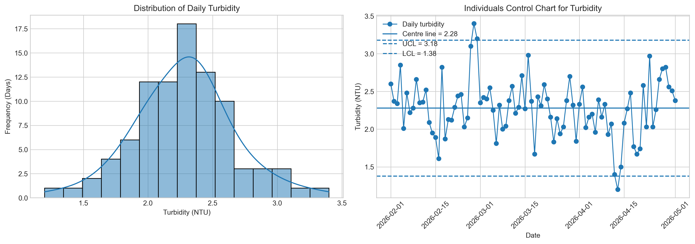
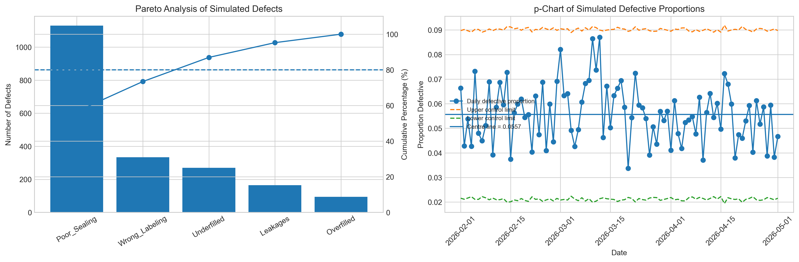
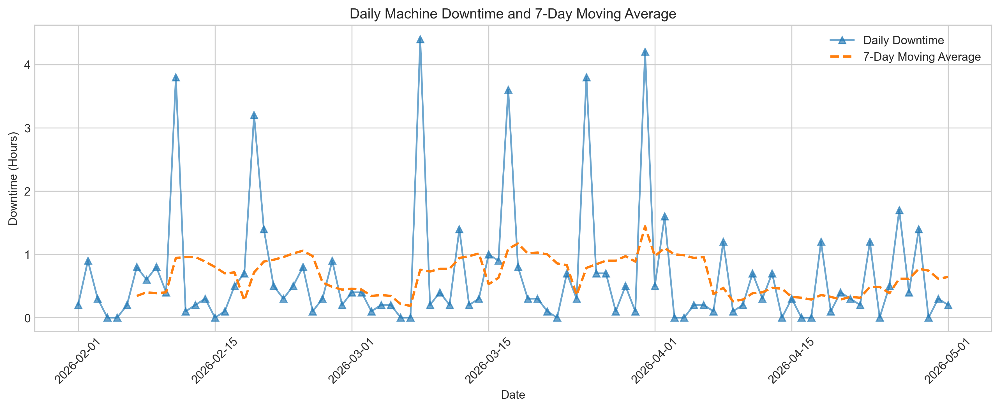
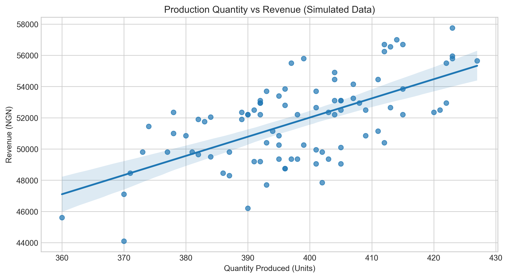

# Statistical Quality Control in Table-Water Production

## Project Overview

This project applies statistical methods to investigate production quality, defect patterns, turbidity measurements, machine downtime, sales-related variables, and questionnaire reliability in a simulated table-water production environment.

The analysis demonstrates how statistical techniques can be used to investigate operational questions, identify patterns, and communicate findings for decision-making.

**Important:** The datasets used in this project are simulated. The results are illustrative and do not represent verified operational findings about Osun State University Water Factory or its staff.

## Objectives

- Quantify the proportion of defective units in the simulated production data.
- Identify the most frequent defect categories using Pareto analysis.
- Examine turbidity measurements using an Individuals control chart.
- Monitor defective proportions using a p-chart.
- Investigate machine downtime patterns.
- Examine the relationship between production quantity and revenue.
- Assess questionnaire internal consistency using Cronbach's alpha.

## Data Overview

The project uses two datasets:

- `master_factory_data.csv`: 90 simulated daily production observations containing 15 variables.
- `staff_questionnaire_data.csv`: 15 simulated questionnaire responses covering five items.

The production dataset covers February 1 to May 1, 2026.

## Tools and Technologies

- Python
- Pandas
- NumPy
- Matplotlib
- Seaborn
- SciPy
- Statsmodels
- Jupyter Notebook

## Analysis Performed

1. Data inspection and preparation.
2. Descriptive statistical analysis.
3. Turbidity analysis using an Individuals control chart.
4. Defect prioritization using Pareto analysis.
5. Monitoring defective proportions using a p-chart.
6. Machine downtime trend analysis using a seven-day moving average.
7. Pearson correlation and ordinary least squares regression.
8. Questionnaire reliability assessment using Cronbach's alpha.
9. Statistical interpretation and documentation of limitations.

## Key Findings

### Production and Defects

- Total simulated production: 35,821 units.
- Total recorded simulated defects: 1,994.
- Overall defective proportion: 5.57%.
- Most frequent defect category: Poor sealing.
- Poor-sealing defects: 1,130.

The defect-category totals were checked against the recorded total number of defective units.

### Production and Revenue

Pearson correlation between production quantity and revenue was 0.6364, with a p-value below 0.001.

The regression model produced an R-squared value of 0.4050, indicating that production quantity accounted for 40.5% of the observed variation in revenue within this simulated sample.

Revenue was calculated as units sold multiplied by a fixed price of ₦150 per unit. The results therefore describe an association in simulated data and do not establish causation.

### Questionnaire Reliability

Cronbach's alpha was -0.565 across five questionnaire items and 15 simulated responses.

The negative coefficient and generally weak item correlations indicate poor internal consistency in the current sample. The questionnaire should not be considered a reliable multi-item scale based on these results.

## Project Files

The repository will contain the analysis notebook, simulated datasets, exported visualizations, and supporting documentation.

A detailed repository structure and file-by-file guide will be added as the project files are organized.

## Project Visualizations

### 1. Water Quality Analysis
Examines simulated turbidity measurements using a histogram
and an Individuals control chart.

### 2. Defect Analysis
Uses Pareto analysis to identify the most frequent defect
categories and a p-chart to monitor the defective proportion.

### 3. Machine Downtime Analysis
Uses a daily trend and a 7-day moving average to examine
patterns in simulated machine downtime.

### 4. Production and Sales Analysis
Examines the relationship between production and revenue
using correlation and linear regression.

## Project Files

- `notebooks/` — Jupyter Notebook containing the analysis.
- `data/` — Simulated production and questionnaire datasets.
- `images/` — Generated charts.
- `docs/DataDictionary.md` — Dataset and variable descriptions.

## Limitations

- The datasets are simulated and do not represent verified
  operational records from the university's water factory.
- The regression identifies an association, not a causal effect.
- Revenue was calculated using a fixed assumed price of ₦150
  per unit sold; it is not verified actual revenue.
- The questionnaire contains only 15 simulated responses.
- Cronbach's alpha was negative (-0.565), indicating poor
  internal consistency among the questionnaire items.
  
## Conclusion

This project demonstrates the application of descriptive statistics, statistical process-control charts, Pareto analysis, correlation, regression, and questionnaire reliability assessment to a simulated production scenario.

It emphasizes data validation, appropriate statistical methods, careful interpretation, and transparent reporting of limitations before making operational recommendations.
## Author

**John Fafiolu**  
Statistics graduate | Data Analytics | Statistical Analysis

[GitHub Profile](https://github.com/JohnFafiolu)

